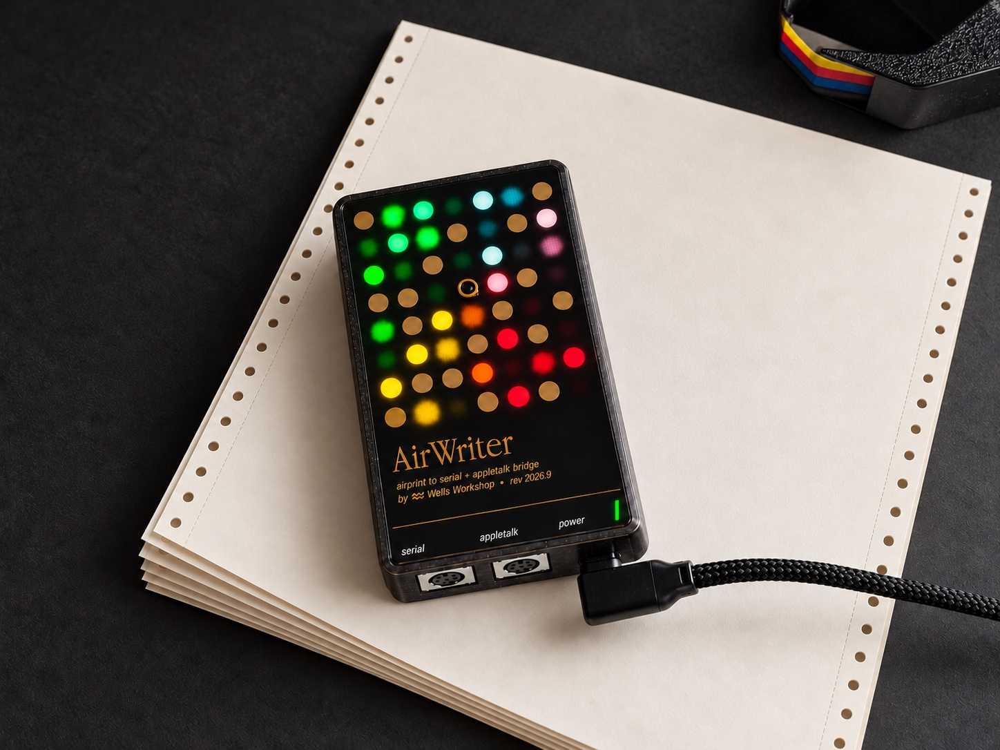

# AirWriter

AirPrint for your vintage Apple printer.

Print from your phone or computer to an Apple ImageWriter, StyleWriter or LaserWriter. Connect
AirWriter to the printer and your Wi-Fi, and the printer shows up like any other. Nothing to
install.

The top is a gold-plated circuit board with 37 lights glowing through it. A rainbow sweeps
across when it starts up, and a few dots glow like fireflies while it's idle.

- **Five-minute setup.** All from your phone.
- **Color.** If your printer does color, so does AirWriter.
- **Vintage Macs too.** Print from a vintage Mac over a LocalTalk cable or your network, or from
  an emulator like Infinite Mac.
- **Up to six printers.** One AirWriter shares them all.
- **Open source.** Hardware and software, free to tinker with.

Buy one from [Wells Workshop](https://shop.wells.ee/products/airwriter).

## What you need

- A vintage Apple printer ([check yours](../../wiki/Supported-Printers))
- The cable your printer uses with a Mac ([which cable](../../wiki/Troubleshooting#crossover-cable))
- A USB-C charger
- 2.4 GHz Wi-Fi

The [wiki](../../wiki) has setup help and troubleshooting. [Updates](../../releases) install over
Wi-Fi.

## How it works

Inside is an ESP32-S3. It shows each printer to your network as an AirPrint printer. Each page
goes out in the printer's own language, down the printer cable or over AppleTalk. LocalTalk runs
on Tashtari's TashTalk, on a small PIC chip.

| Path | Contents |
|---|---|
| `firmware/` | ESP-IDF application (ESP32-S3) |
| `tools/` | Host builds of the raster and IPP code, tests, fixtures and the settings page |
| `hardware/` | KiCad board and front panel |
| `enclosure/` | Case and light-guide lattice in build123d, with printable STLs in `out/` |

Firmware builds with ESP-IDF 5.5 (`idf.py -C firmware build`). Host tests run anywhere with a C
compiler: `make -C tools/rip test regress` and `make -C tools/ipp test`. `AGENTS.md` has the full
toolchain notes.

## Credits

LocalTalk runs on Tashtari's [TashTalk](https://github.com/lampmerchant/tashtalk). Monroe
Williams worked out the StyleWriter's serial protocol in the 1990s and wrote
[lpstyl](https://github.com/Godzil/lpstyl). FeralFirmware took Apple's StyleWriter and LaserWriter 300
drivers apart for [TailTalk](https://github.com/FeralFirmware/TailTalk) and InkTalk. Thank you all.

## License

Firmware and tools are GPL-3.0-or-later, hardware and enclosure CERN-OHL-S-2.0, docs CC-BY-SA-4.0.
See [`LICENSE.md`](LICENSE.md), which also covers third-party material.
